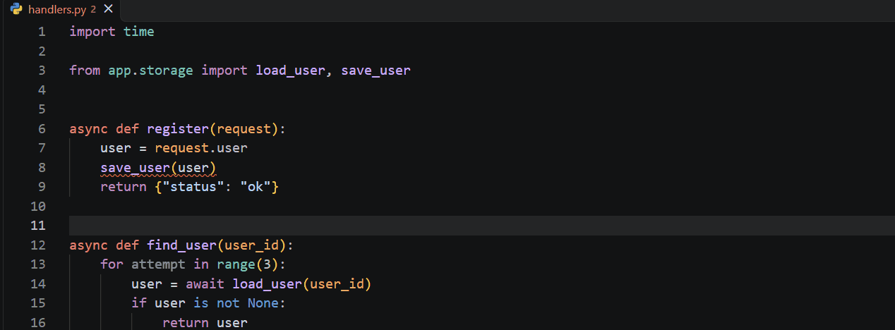
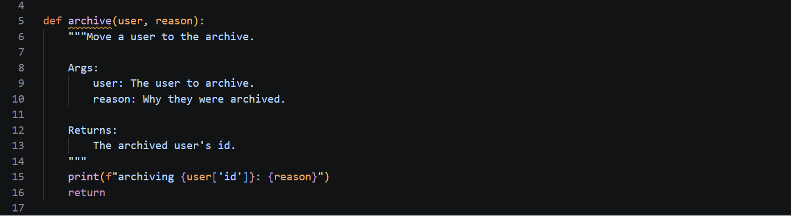

# liar

**A static analyser that finds Python code which says one thing and does another.**

[](https://marketplace.visualstudio.com/items?itemName=Momo4811.liar)

```
error[C1]: 'save_user' is never awaited. this line does nothing.
 --> handlers.py:12:5
  |
12|     save_user(request.user)
  |     ^^^^^^^^^^^^^^^^^^^^^^^
```

Calling an async function without `await` builds a coroutine and throws it away.
The body never runs, nothing raises, and the endpoint cheerfully returns
success. It isn't a style opinion — the code does not run.



---

## It finds real bugs

Pointed at 19 async-heavy packages from PyPI — 1,305 files — it found this:

```
warning[C2]: 'time.sleep' blocks. every other task waits for it.
   --> redis/asyncio/cluster.py:994:25
    |
994 |                         time.sleep(watch_delay)
    |                         ^^^^^^^^^^^^^^^^^^^^^^^
```

A synchronous sleep inside `async def transaction`, in the retry path of an
async Redis cluster client. Async code shares one thread between many tasks, so
for the length of that delay *every other task in the process stops*. The fix is
`await asyncio.sleep(watch_delay)`.

One finding, one true positive. The full triage, including a false positive
found and fixed, is in [`corpus/triage.md`](corpus/triage.md).

## What it checks

| | |
|---|---|
| **C1** | An async function called without `await` |
| **C2** | A blocking call inside async code, directly or through a sync helper |
| **C3a** | A name that asks a question whose answer is not a boolean |
| **C3b** | A name that promises a number and holds something else |
| **C3e** | A name that says nothing, over a scope long enough to matter |
| **C3f** | One name meaning several unrelated things |
| **C4** | A resource not released on every path out — *including the invisible ones* |
| **C5** | A docstring the code disagrees with |

```
warning[C3f]: 4 variables called 'payload' in this file. none are related.
 --> handlers.py:1:1
  |
1 | payload = 1
  | ^^^^^^^
2 | payload = "x"
  | ------- str
3 | payload = []
  | ------- list
4 | payload = {}
  | ------- dict
```

One finding with a label per occurrence, not four findings — the complaint is
about the group.

```python
def read_config(path):
    f = open(path)
    data = parse(f.read())   # if this raises...
    f.close()                # ...this never runs
    return data
```

```
error[C4]: 'f' is released on 2 of 3 paths.
 --> config.py:2:5
  |
2 |     f = open(path)
  |     ^
```

Fine on the happy path. Leaks a handle every time `parse` raises, and you find
out when the process hits the OS descriptor limit a long way from the line
responsible. Catching it needs a real control flow graph with **exception
edges** — the admission that almost every statement in Python has an invisible
edge leaving it — which is why other linters don't.

Every check is off-switchable per project, and none of them fire on anything
the engine is unsure about.

## The rule the whole thing hangs on

> **When unsure, stay silent.**

Every finding asks a stranger to go and change their code. A tool at 60%
accuracy gets muted; at 90% it gets read. So every ambiguity resolves toward
saying nothing — an unresolvable name, an unrecognised decorator, a value whose
type can't be known. It misses real bugs this way, deliberately.

The test suite is shaped by that: **76 negative fixtures against 37 positive
ones**. Tests asserting a bug is found measure recall. False positives are the
only thing that can kill a linter, so most of the suite asserts that it
correctly says *nothing*.

Most of those negative fixtures were not imagined — they were minimised from
real code that the tool got wrong. Each new check's first run against 1,305
files of real packages went the same way:

| | first run | after triage |
|---|---|---|
| C3 — the naming checks | 887 | 140 |
| C5 — docstrings | 1,403 | 39 |

Every false positive became a permanent fixture *before* it was fixed, so none
can come back. The whole account — including the ones still wrong and why they
are not fixed — is in [`corpus/triage.md`](corpus/triage.md).

The most useful thing the corpus taught was about the tests. C5's Google-style
parser ended a section at indentation zero, and **every fixture used unindented
text**, so nothing caught it until real code did. A fixture that does not look
like the real thing tests something adjacent to the real thing.

Places it is deliberately blind, each with a fixture proving it:

- a method on an object whose type is unknown — `service.save()`
- anything imported from a module not being analysed
- any decorated definition — `@gen_test` can turn a coroutine function into a
  synchronous one, and then the un-awaited call is correct
- a coroutine assigned to a name that is used again for anything at all
- an instance of any class, for the naming checks — a class can implement
  `__bool__` or `__len__`, so `is_valid` holding one may be telling the truth
- a `None` initialiser, which is a legitimate starting value for anything
- a boolean under a quantity name, because `prepend_size = True` is a verb
  phrase and not a broken promise about a number

**Recall is not reported, and won't be.** There's no way to know which bugs were
missed without a labelled ground truth that doesn't exist. Inventing a recall
number would be the exact dishonesty this tool is named after.

## It has a voice

The humour comes from being accurate, not from jokes — a gag is funny once and
irritating on the two-hundredth run.

```
professional   coroutine 'save_user' is called but never awaited
dry            'save_user' is never awaited. this line does nothing.
brutal         you wrote 'save_user()' and then threw it away.
```

```bash
liar check src/ --tone brutal
```

Dry is the default. `professional` exists so the tool is usable at work, which
is both a genuine kindness and, in itself, the joke.



## In your editor

A language server ships alongside the CLI, and a VS Code extension launches it.
Findings appear as you save, in the tone you chose, with a one-click fix for the
missing `await`:

```
Add await
  save_user(request.user)
  ^ inserts "await " here
```

The fix is offered only inside an `async def`. Adding `await` in a plain `def`
would produce a syntax error, which is a worse outcome than the bug it was
meant to fix.

```bash
cargo install --git https://github.com/Momo4811/liar liar-lsp   # puts liar-lsp on PATH
code --install-extension Momo4811.liar                          # or search "liar" in Extensions
```

Settings are `liar.enable`, `liar.tone` and `liar.path`. The extension is about
140 lines of TypeScript and holds no analysis logic whatsoever — the server
decides what a finding is, so the editor and the command line can never
disagree. They also read the same `liar.toml` and choose files by the same code:
a project's `ignore` and `exclude` apply in both, and virtual environments are
skipped by both, recognised by their `pyvenv.cfg` rather than their name.

The extension is tested the way a user meets it. CI builds the `.vsix`, unpacks
exactly what it contains, and runs it inside a real VS Code against the real
server: it activates, findings appear, `Add await` is offered in `async def`
and not in `def`, changing the tone rewords them, and applying the fix and
saving clears the finding. The first package built had left out its own
dependencies and could not load; testing the development folder would have
passed anyway, which is why the test does not.

## Running it

```bash
cargo run --release -p liar-cli -- check path/to/project
```

Configuration is read from `liar.toml` in the current directory, or from
`--config path/to/liar.toml`:

```toml
ignore = ["C3e"]            # turn a check off
exclude = ["generated/**"]  # skip files
scope-threshold = 60        # C3e: lines of scope before a name must say something
```

Exit codes follow the usual linter convention: `0` clean, `1` findings, `2` the
tool itself failed — so a build script can tell "your code has problems" from
"liar could not run".

When a finding surprises you, ask the engine what it thought:

```bash
$ liar debug resolve app.py:6:5
name:   save
scope:  Function { is_async: true }

resolves to: Function { is_async: true, decorated: false }
defined at:  helpers.py:1:11
```

## How it works

```
  .py files  →  parse  →  index  →  checks  →  report
```

**Parse.** `ruff_python_parser`, confined to a single private module. No
third-party parser type appears anywhere else, which is what makes depending on
an unstable `0.0.x` crate a contained risk rather than a structural one.

**Index.** Scopes, bindings, and imports resolved *between* files, so a name
imported from elsewhere resolves to its real definition. Every check goes
through it rather than matching names textually — a check that matches text is a
regex with extra steps, and it's how false positives get in.

One rule there matters more than the rest: a class body's names are invisible to
functions nested inside it. `class C: x = 1` does not make `x` a bare name in a
method — Python raises `NameError`. Treating it as visible would invent bindings
that don't exist, and every check downstream would inherit the mistake.

**Checks.** Each declares only what it tracks and what counts as a bug. C2's
table of blocking functions is data, keyed on real module paths, so `time.sleep`
matches whether it was written `import time`, `import time as t`, or
`from time import sleep`.

Everything is arena-allocated and referenced by typed integer index — the way
`rustc` and `ruff` are both built. `#![forbid(unsafe_code)]`.

## Tests

```bash
cargo test        # 389 tests
```

Fixtures declare their expectations inline, and **an unexpected finding fails as
loudly as a missing one** — without that, a file with no comments would assert
nothing and every negative fixture would be inert:

```python
def is_ready() -> str:   # expect: C3a
    return "yes"

def is_done() -> bool:   # no comment == must produce nothing
    return True
```

Every false positive found in the corpus is minimised into a permanent negative
fixture *before* it is fixed, so the suite grows with everything real code has
taught it and no false positive can return.

## Status

All eight checks work, along with the engine they sit on: the index, type
inference, control flow graphs with exception edges, a dataflow solver, the
corpus tooling, the CLI, the language server and the VS Code extension.

The extension is on the [VS Code Marketplace](https://marketplace.visualstudio.com/items?itemName=Momo4811.liar).

**C3e is the weakest thing here and it is worth saying so.** It has no
correctness content: it is a style opinion about uninformative names, and a
defensible one, but a team that disagrees should turn it off with
`ignore = ["C3e"]`. Everything else in the tool is about code that does not do
what it says.

Design notes and the reasoning behind each decision are in
[`docs/`](docs/) — including why the parser was chosen, what was given up for
it, and a false positive found in the wild and fixed.

## Licence

MIT.
