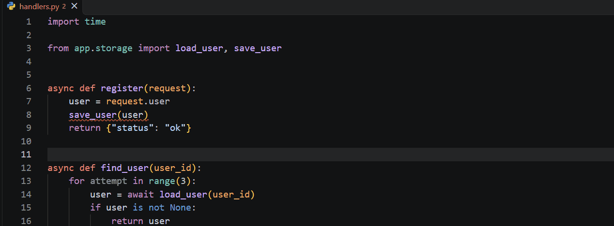
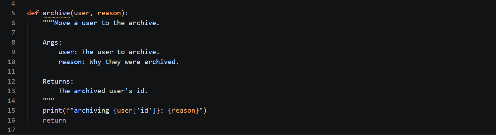

# liar

**Finds Python code that says one thing and does another.**

```
'save_user' is never awaited. this line does nothing.
```

An async function called without `await` builds a coroutine and throws it
away. The body never runs, nothing raises, and the endpoint cheerfully returns
success. liar underlines it the moment you save, and offers to add the `await`.



## What it finds

| | |
|---|---|
| **C1** | An async function called without `await` |
| **C2** | A blocking call inside async code, directly or through a sync helper |
| **C3a** | A name that asks a question whose answer is not a boolean |
| **C3b** | A name that promises a number and holds something else |
| **C3e** | A name that says nothing, over a scope long enough to matter |
| **C3f** | One name meaning several unrelated things |
| **C4** | A resource not released on every path out, including when something raises |
| **C5** | A docstring the code disagrees with |

It is built to stay quiet when it is unsure. An unresolvable name, an
unrecognised decorator, or a value whose type cannot be known all produce
nothing. It will miss some real bugs as a result, and it will rarely waste your
time.

## Requirements

The extension starts the `liar-lsp` language server, which does the analysis.
Install it with a recent stable Rust:

```bash
cargo install --git https://github.com/Momo4811/liar liar-lsp
```

If it is not on your `PATH`, point `liar.path` at it.

## Features

- Findings on save, for the whole project, so changing `helpers.py` updates
  the findings in the files that import it.
- **Add await**, a quick fix for C1, offered only inside `async def`. Adding
  `await` inside a plain `def` would be a syntax error.
- Three tones for the same finding:

  ```
  professional   coroutine 'save_user' is called but never awaited
  dry            'save_user' is never awaited. this line does nothing.
  brutal         you wrote 'save_user()' and then threw it away.
  ```

  

## Settings

| Setting | Default | |
|---|---|---|
| `liar.enable` | `true` | Run liar on Python files |
| `liar.tone` | `dry` | `professional`, `dry` or `brutal` |
| `liar.path` | | Path to `liar-lsp`. Empty means look on `PATH` |

## Project configuration

A `liar.toml` at the workspace root is read by both the editor and the
`liar` command line, so the two always agree:

```toml
ignore = ["C3e"]            # turn a check off
exclude = ["generated/**"]  # skip files
scope-threshold = 60        # C3e: lines of scope before a name must say something
```

Changes apply as soon as the file is saved. Virtual environments,
`node_modules` and `__pycache__` are never analysed.

## More

The checks, how they were tested against 1,305 files of real code, and every
false positive found along the way are in the
[repository](https://github.com/Momo4811/liar).
